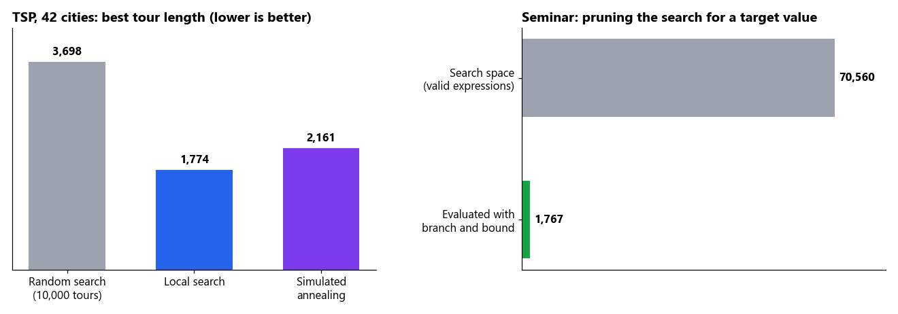

# Master's in Artificial Intelligence — Coursework (VIU) 🤖

Selected coursework from my **Master's Degree in Artificial Intelligence** at Universidad Internacional de Valencia
(2024–2025): classic algorithm design, dynamic programming, metaheuristics and complexity analysis, implemented in
Python notebooks (explanations in Spanish).


## Highlights



- **Closest pair of points:** brute force in $O(n^2)$ vs. divide and conquer in $O(n \log n)$, extended from 1D to
  2D and 3D.
- **Travelling salesman (42 cities):** random search over 10,000 tours reaches 3,698; local search improves it to
  **1,774** in 35 iterations; simulated annealing is also implemented and compared.
- **Branch and bound:** to build an expression with five digits and four operators that hits a target, pruning
  evaluates **1,767** candidates out of a 70,560-expression search space.
- Also: Tower of Hanoi, N-Queens backtracking, greedy coin change, a river-trip pricing problem solved with dynamic
  programming, task assignment and gradient descent.

## Optimization Algorithms

| Notebook | Topic |
|---|---|
| [`Oscar_Cuenca_AG1.ipynb`](Algoritmos_Optimizacion/Oscar_Cuenca_AG1.ipynb) | Recursion, greedy and backtracking (Hanoi, coin change, N-Queens), dynamic programming and the closest pair of points |
| [`Oscar_Cuenca_AG2.ipynb`](Algoritmos_Optimizacion/Oscar_Cuenca_AG2.ipynb) | Dynamic programming (river trip), task assignment problem and gradient descent |
| [`Oscar_Cuenca_AG3.ipynb`](Algoritmos_Optimizacion/Oscar_Cuenca_AG3.ipynb) | Metaheuristics on the TSP: random search, local search and simulated annealing |
| [`OscarCuencaMoreno_Seminario.ipynb`](Algoritmos_Optimizacion/OscarCuencaMoreno_Seminario.ipynb) | Seminar project: digits and operators — reachable values, brute force vs. branch and bound, complexity |
| [`Articulo_Cientifico_AO_VIU_New.pdf`](Algoritmos_Optimizacion/Articulo_Cientifico_AO_VIU_New.pdf) | Scientific article written for the course |

## Programming Tools

| Notebook | Topic |
|---|---|
| [`actividad1.ipynb`](Herramientas_Programacion/Portafolio/actividad1.ipynb) | String processing exercises in Python |
| [`actividad2.ipynb`](Herramientas_Programacion/Portafolio/actividad2.ipynb) | Dictionaries and data aggregation; includes a heart-disease dataset (`heart.csv`) |

## Running the notebooks

```bash
pip install jupyter numpy pandas matplotlib
jupyter notebook
```

## Related

- Master's thesis: *Banana Leaf Disease Detection Using CNNs Through a Mobile App* —
  mobile client in [BananaGuard](https://github.com/CuencaOscar/BananaGuard).

## License

The code and notebooks are MIT-licensed. The heart-disease dataset and course materials belong to their respective authors.

[MIT](LICENSE) © Oscar Cuenca · [LinkedIn](https://www.linkedin.com/in/ocuenca-moreno/)
