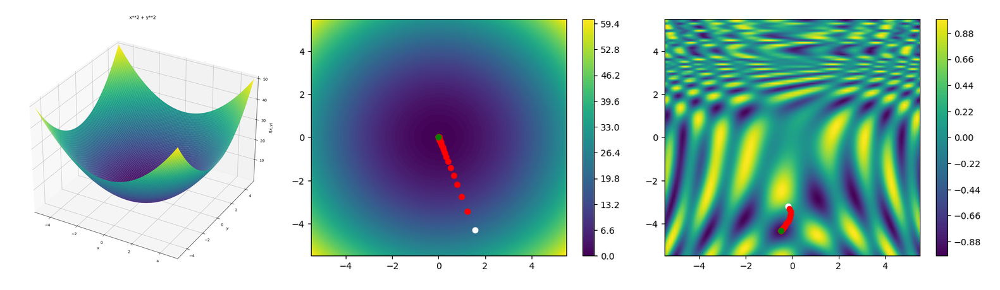

# Master's in Artificial Intelligence — Coursework (VIU) 🤖

Selected coursework from my **Master's Degree in Artificial Intelligence** at
Universidad Internacional de Valencia (2024–2025). Notebooks are written in Python and
Jupyter, with explanations in Spanish.




## Algoritmos de Optimización (Optimization Algorithms)

| Notebook | Topic |
|---|---|
| [`Oscar_Cuenca_AG1.ipynb`](Algoritmos_Optimizacion/Oscar_Cuenca_AG1.ipynb) | Closest pair of points: brute force vs. divide and conquer, with complexity analysis |
| [`Oscar_Cuenca_AG2.ipynb`](Algoritmos_Optimizacion/Oscar_Cuenca_AG2.ipynb) | Dynamic programming (river trip), task assignment problem and gradient descent |
| [`Oscar_Cuenca_AG3.ipynb`](Algoritmos_Optimizacion/Oscar_Cuenca_AG3.ipynb) | Metaheuristics: random search, local search and simulated annealing |
| [`OscarCuencaMoreno_Seminario.ipynb`](Algoritmos_Optimizacion/OscarCuencaMoreno_Seminario.ipynb) | Programming project: combining digits and operations — reachable min/max values and full coverage of the integer range |
| [`Articulo_Cientifico_AO_VIU_New.pdf`](Algoritmos_Optimizacion/Articulo_Cientifico_AO_VIU_New.pdf) | Scientific article written for the course |

## Herramientas de Programación (Programming Tools)

| Notebook | Topic |
|---|---|
| [`actividad1.ipynb`](Herramientas_Programacion/Portafolio/actividad1.ipynb) | String processing exercises in Python |
| [`actividad2.ipynb`](Herramientas_Programacion/Portafolio/actividad2.ipynb) | Dictionaries and data aggregation; includes a heart-disease dataset (`heart.csv`) |

## Running the notebooks

```bash
pip install jupyter numpy pandas matplotlib
jupyter notebook
```

## Related

- Master's thesis: *Banana Leaf Disease Detection Using CNNs Through a Mobile App* —
  mobile client in [BananaGuard](https://github.com/CuencaOscar/BananaGuard).

---

**Oscar Cuenca** · [LinkedIn](https://www.linkedin.com/in/ocuenca-moreno/)
